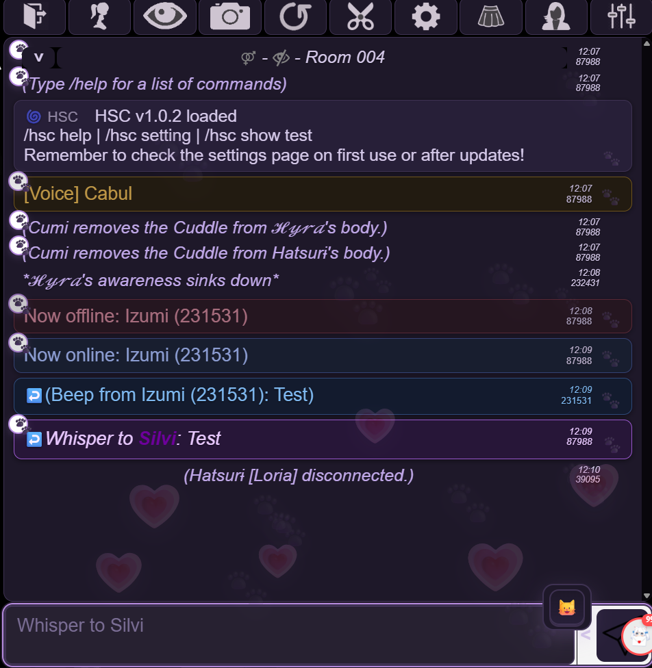
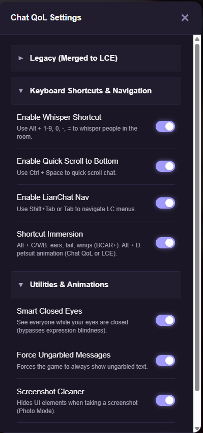
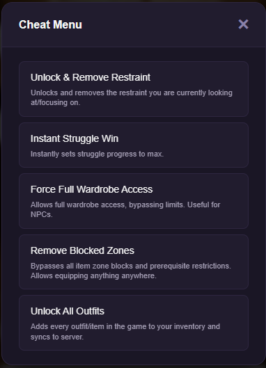

<div align="center">
  
  <h1>BC Android</h1>
  <p>Ultra-compact, memory-optimized native Android client for BC</p>

  <p>
    <a href="https://github.com/Izumii99/BC-Android/releases"></a>
    <a href="https://github.com/Izumii99/BC-Android/releases"></a>
  </p>
  <p>
    
    
    
    
  </p>
</div>

---

A minimal native Android wrapper for BC, built with **Kotlin** and **Android WebView**. Designed specifically to replace bloated mobile browsers by leveraging the OS-native WebKit engine with aggressive memory management, zero browser chrome, portrait-first canvas scaling, and continuous background session retention.

## Features

- **Zero-Bar Immersive Fullscreen:** Pure edge-to-edge experience without address bars, navigation buttons, tab switchers, or settings panels.
- **Portrait-First Scaling Engine:** Intelligently fits the native 2:1 game canvas to portrait phone displays with zero horizontal overflow, while automatically yielding to portrait addons (such as BC-LCE or MPL) when active.
- **Background Session Persistence & Anti-Shutdown:** Integrated background keep-alive service (`ConnectionKeeperService`) maintaining active WebSocket room connections and game timers even when the app is minimized or the screen is locked, preventing aggressive OEM battery killer disconnects.
  > [!TIP]
  > **For Uninterrupted 24/7 Background Running:** On aggressive OEM systems (Xiaomi MIUI/HyperOS, Samsung OneUI, Vivo, Oppo):
  > 1. Set app battery setting to **"No restrictions"** (Unrestricted).
  > 2. Disable **"Pause app activity if unused"**.
  > 3. Enable **"Autostart"** (Mulai otomatis).
  > 4. **Lock the app in Recent Apps** (long-press the app card in Recent Apps and tap the Padlock icon) to prevent OEM task killers from killing the process during heavy multitasking.
- **Native "Open with" System App Chooser:** Tapping external links (GitHub addon repositories, Discord links, guides, bug trackers) or scripts triggering `window.open` launches Android's native system app picker, allowing you to view external content in Chrome, Firefox, or official apps without ever disrupting your active game room session.
- **Smart Back Navigation & Double-Tap Protection:** Intelligently navigates back from external web pages to the game canvas, while reserving the double-tap exit confirmation strictly for the active game room to prevent accidental disconnections.
- **Aggressive Memory & Battery Optimization:**
  - Redraws automatically throttle down to **1 FPS** and canvas rendering is completely bypassed when the app is paused or screen is locked.
  - Active memory pruning via Android `onTrimMemory` hooks clears non-essential cache buffers during long sessions without disconnecting WebSocket connections.
- **Auto-Detects Latest Game Version:** Probes server endpoints concurrently on startup to launch the newest live game release (`R132+`). Supports manual version override or locking via a local `version.txt` file (e.g. `133:lock`).
- **Instant In-App Updates & Auto-Clean Cache:** Automatically detects new APK releases on launch and provides seamless 1-tap in-app download and direct package installation. Downloaded APKs are stored in private internal sandbox cache and automatically cleaned up on startup, keeping your device's Downloads folder completely clutter-free.
- **Crash Auto-Recovery:** Automatically recovers and restarts frozen or memory-exhausted WebKit render processes with rapid crash-loop guards.
- **Native Clipboard & Soft Keyboard Bridge:** Full support for copying appearance codes, wardrobe exports, and chat logs with 1-tap clipboard integration and keyboard auto-resizing (`adjustResize`).
- **Native System File Chooser:** Full support for HTML `<input type="file">`, allowing seamless import/export of appearances, wardrobe codes, custom backgrounds, and backup files directly through the Android system file picker (Recent, Downloads, Gallery).
- **Context-Aware Dynamic Pinch-to-Zoom:** Enables pinch-to-zoom (up to 5x magnification) across standard landscape screens (such as the Lobby/Main Hall and non-portrait menus) for effortless readability of small buttons and text, while automatically locking zoom in portrait mode (BC-LCE vertical chatrooms and vertical room search UI) to ensure stable docking without gesture misalignments.
- **Discreet / Stealth Flavor:** Includes an optional build with a minimal app name (`"BC"`) and transparent launcher icon for complete privacy.

---

## Included Addons & Script Ecosystem

> [!TIP]
> **Centralized Upstream Distribution Hub:**  
> All addon scripts are maintained upstream in the **[BC-Desktop](https://github.com/Izumii99/BC-Desktop)** repository. The Android client automatically receives over-the-air (OTA) updates on startup via jsDelivr and GitHub Pages, and includes built-in offline fallbacks out-of-the-box.

### 1. Neko Dark Mode (`neko-dark.js`)

A custom dark theme tailored for **Neko Chat Enhancer**, replacing harsh white backgrounds with a sleek purple aesthetic.



### 2. Chat QoL & Emoticons (`chat-qol.js`)

Translates text emoticons into character expressions, forces ungarbled messages, and streamlines mobile chat room interactions.



### 3. Addon Manager UI (`addon-manager.js`)

A built-in GUI to manage all your installed addons and compatible community scripts in one place with simple toggle switches.


### 4. Cheat Menu (`cheat-menu.js`)

Quick-access floating draggable menu providing convenient shortcuts and utilities for testing, instant escape, wardrobe overrides, and NPC manipulation.



> [!NOTE]
> **Wardrobe Pagination:**  
> Modern versions of Bondage Club Extended (BCX) have wardrobe and appearance pagination natively integrated into their core, eliminating the need for standalone monkey-patch scripts.

---

## Why not Mobile Browsers?

| Feature / Metric | Mobile Browsers (Chrome / Kiwi / Firefox) | BC Android (Native Client) |
| :--- | :--- | :--- |
| **App Size** | ~100 MB – 250 MB | **~0.9 MB** (Ultra-compact) |
| **RAM Footprint (Idle)** | ~400 MB – 700 MB | **~40 MB – 80 MB** (Aggressive trim hooks) |
| **Background Room Retention** | Disconnects after 1–3 minutes | **24/7 Persistent** (Foreground keeper service) |
| **Screen Real Estate** | Cluttered by URL bar & navigation bars | **100% Immersive Zero-Bar** edge-to-edge |
| **Background Battery Drain** | Burns full 60 FPS in background | **1 FPS & Zero-Render Throttle** on minimize / screen-off |
| **External Links** | Hijacks game tab and drops room | **Native "Open with" Chooser** in external apps |
| **Accidental Exits** | Swipes easily exit or reload room | **Double-Tap Back Guard** & Smart Navigation |

---

## Downloads & Variants

Every release provides two distinct APK variants:

| Variant | Size | Description |
| :--- | :--- | :--- |
| **Standard APK** | ~0.9 MB | Full branded release with official rope coil launcher icon and title. |
| **Discreet APK** | ~0.9 MB | Stealth build with minimal "BC" app name and transparent icon. |

Download the latest APK directly from the [Releases](https://github.com/Izumii99/BC-Android/releases) page.

---

## Building from Source

### Prerequisites
- JDK 17 or newer
- Android SDK (API 34, Build Tools 34.0.0)

### Quick Build (Command Line)
```bash
# Clone the repository
git clone https://github.com/Izumii99/BC-Android.git
cd BC-Android

# Build both Standard and Discreet release APKs
./gradlew assembleStandardRelease assembleDiscreetRelease
```

Generated APKs will be located in:
- `app/build/outputs/apk/standard/release/app-standard-release.apk`
- `app/build/outputs/apk/discreet/release/app-discreet-release.apk`

### Local PowerShell Build Script
On Windows, you can also run the automated build script:
```powershell
.\build_all.ps1
```

---

## Running Tests

To run the automated unit test suite locally:

```powershell
./gradlew test
```

---

## Project Structure

```text
BC-Android/
├── .github/
│   └── workflows/
│       ├── checks.yml                        — CI unit test runner & lint verification
│       └── release.yml                       — Automated multi-flavor APK builder & release
├── app/
│   ├── src/main/
│   │   ├── java/com/izumii/bcandroid/
│   │   │   ├── MainActivity.kt               — WebView host, immersive mode, file chooser & lifecycle
│   │   │   ├── WebAppInterface.kt            — JavaScript bridge (clipboard, downloads, haptics)
│   │   │   ├── memory/
│   │   │   │   └── MemoryOptimizer.kt        — Low-memory trim callbacks, cache pruning & FPS throttle
│   │   │   ├── service/
│   │   │   │   └── ConnectionKeeperService.kt — 24/7 silent background keep-alive (WifiLock & WakeLock)
│   │   │   ├── updater/
│   │   │   │   └── VersionDetector.kt        — Dynamic server detection & in-app APK updater
│   │   │   └── scripts/
│   │   │       └── ScriptLoader.kt           — Offline fallback addon injection
│   │   ├── assets/
│   │   │   ├── addons/                       — Offline fallback addon bundle (synced from BC-Desktop)
│   │   │   ├── scripts/                      — Desktop bridge & remote loader scripts
│   │   │   └── portrait_adapter.js           — Dynamic 2:1 canvas scaling & zoom controller
│   │   ├── res/                              — App layouts, drawables, launcher icons & themes
│   │   └── AndroidManifest.xml               — Permissions (WakeLock, WifiLock, Battery Exempt)
│   ├── src/test/                             — Automated JUnit test suite
│   │   ├── ScriptDistributionTest.kt         — Addon hub & fallback integrity tests
│   │   └── VersionDetectorTest.kt            — SemVer tag comparison & calendar formula tests
│   └── build.gradle.kts                      — Android app configuration (SDK 34, flavors, SemVer)
├── Assets/                                   — Readme screenshots, banner & launcher branding
├── build_all.ps1                             — Release APK compile & packaging script
├── build-local.ps1                           — Fast local debug build & adb push tool
├── RELEASE_NOTES.md                          — User-facing changelog & release details
└── settings.gradle.kts                       — Gradle project root settings
```

---

## License

This project is licensed under the [MIT License](LICENSE).
