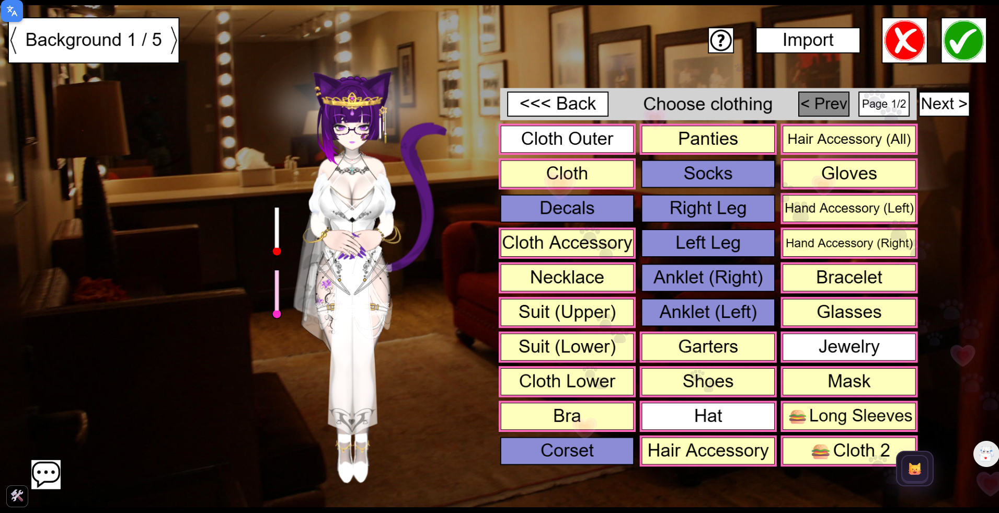

<div align="center">
  
  <h1>BC Android</h1>
  <p>Ultra-compact, memory-optimized native Android client for BC</p>

  <p>
    <a href="https://github.com/Izumii99/BC-Android/releases"></a>
    <a href="https://github.com/Izumii99/BC-Android/releases"></a>
  </p>
  <p>
    
    
    
    
  </p>
</div>

---

A minimal, native Android wrapper for BC, built with **Kotlin** and **Android WebView**. Designed specifically to replace bloated mobile browsers by leveraging the OS-native WebKit engine with aggressive memory management, zero browser chrome, and portrait-first canvas scaling.

## Features

- **Zero-Bar Immersive Fullscreen:** Pure edge-to-edge experience without address bars, navigation buttons, tab switchers, or settings panels.
- **Portrait-First Scaling Engine:** Intelligently fits the native 2:1 game canvas to portrait phone displays with zero horizontal overflow, while automatically yielding to portrait addons (such as BC-LCE or MPL) if active.
- **Background Session Persistence:** Integrated background keep-alive service (`ConnectionKeeperService`) maintaining active WebSocket room connections and game timers even when the app is minimized or the screen is locked, preventing aggressive OEM battery killer disconnects.
- **Aggressive Memory & Battery Optimization:**
  - Redraws automatically throttle down to **15 FPS** when the app is paused or screen is locked.
  - Active memory pruning via Android `onTrimMemory` hooks clears non-essential cache buffers during long sessions without disconnecting WebSocket connections.
- **Auto-Detects Latest Game Version:** Probes server endpoints concurrently on startup to launch the newest live game release (R132+).
- **Crash Auto-Recovery:** Automatically recovers and restarts frozen or memory-exhausted WebKit render processes with rapid crash-loop guards.
- **Native Clipboard & Soft Keyboard Bridge:** Full support for copying appearance codes, wardrobe exports, and chat logs with 1-tap clipboard integration and keyboard auto-resizing (`adjustResize`).
- **Discreet / Stealth Flavor:** Includes an optional build with a minimal app name (`"BC"`) and transparent launcher icon for complete privacy without package-name fallbacks.
- **Double-Tap Back Protection:** Prevents accidentally quitting your active game room session via gestures.

## Included Scripts / Addons

The client bundles mobile-friendly adaptations of standalone quality-of-life scripts:

### 1. Neko Dark Mode (`neko-dark.js`)
A custom dark theme tailored for **Neko Chat Enhancer**, replacing harsh white backgrounds with a sleek purple aesthetic.
<br><br>


### 2. Wardrobe & Appearance Pagination (`wardrobe-pagination.js`)
Prevents clothing lists and wardrobe items from overflowing beyond screen boundaries.
<br><br>
<p float="left">
  
  
</p>

### 3. Chat QoL & Emoticons (`chat-qol.js`)
Translates text emoticons into character expressions and streamlines mobile chat room interactions.
<br><br>


### 4. Addon Manager & Cheats (`addon-manager.js`, `cheat-menu.js`)
Standalone management utilities for loading, toggling, and configuring custom addons on mobile.

---

## Downloads & Variants

Every release provides two distinct APK variants:

| Variant | Size | Description |
| :--- | :--- | :--- |
| **Standard APK** | ~0.86 MB | Full branded release with official rope coil launcher icon and title. |
| **Discreet APK** | ~0.86 MB | Stealth build with minimal "BC" app name and transparent icon. |

Download the latest APK directly from the [Releases](https://github.com/Izumii99/BC-Android/releases) page.

---

## Building from Source

### Prerequisites
- JDK 17 or newer
- Android SDK (API 34, Build Tools 34.0.0)

### Quick Build (Command Line)
```bash
# Clone the repository
git clone https://github.com/Izumii99/BC-Android.git
cd BC-Android

# Build both Standard and Discreet release APKs
./gradlew assembleStandardRelease assembleDiscreetRelease
```

Generated APKs will be located in:
- `app/build/outputs/apk/standard/release/app-standard-release.apk`
- `app/build/outputs/apk/discreet/release/app-discreet-release.apk`

### Local PowerShell Build Script
On Windows, you can also run the automated build script:
```powershell
.\build_all.ps1
```

---

## Architecture & Memory Strategy

Standard mobile browsers retain full browsing tabs, pre-rendering engines, background telemetry, and extensive cache structures that consume 500MB–1GB+ of memory during extended BC sessions.

**BC Android achieves a ~40–80MB baseline memory footprint through:**
1. **Direct WebKit Host:** Runs in a single dedicated process with no browser chrome overhead.
2. **Dynamic Unfocused FPS Throttle:** Injects a script capping redraws to 15 FPS when minimized or screen-off, slashing GPU texture allocations and battery heat.
3. **Low-Memory Callbacks:** Hooks into Android's `ComponentCallbacks2` to actively dump volatile bitmap caches upon receiving `TRIM_MEMORY_RUNNING_CRITICAL` or `TRIM_MEMORY_UI_HIDDEN`.
4. **Crash-Loop Guard:** Detects WebKit render terminations and smoothly resurrects the page state up to 3 times within 30 seconds without hard-crashing the application.

---

## License

This project is licensed under the [MIT License](LICENSE).
